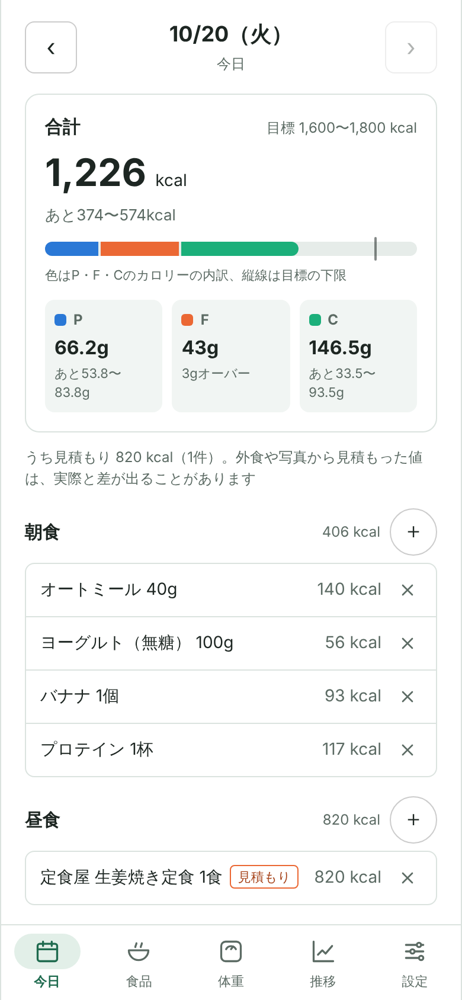
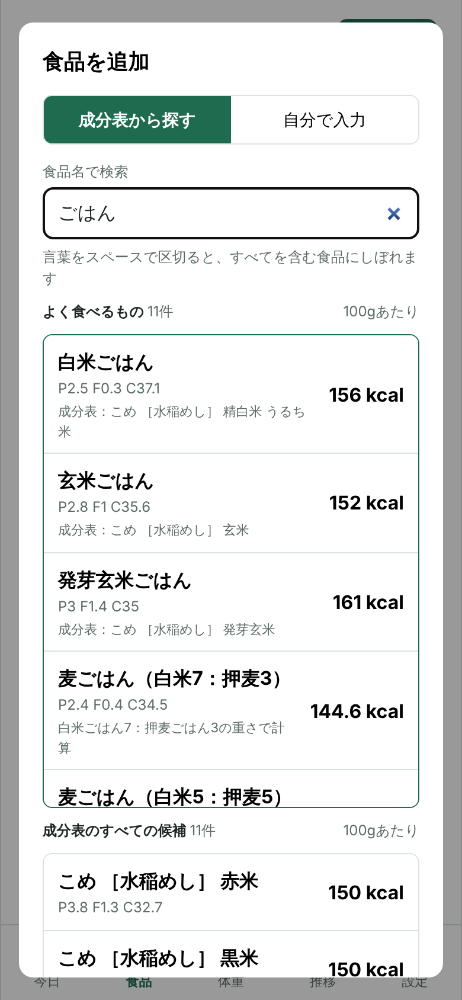
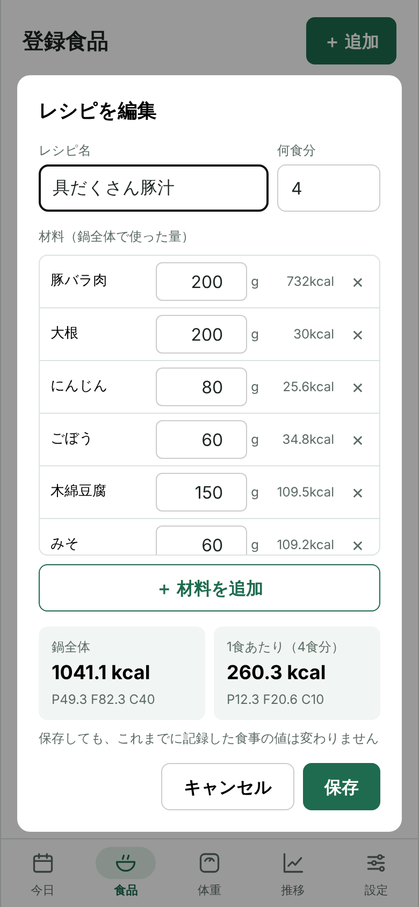
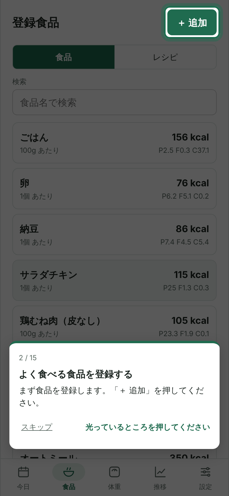
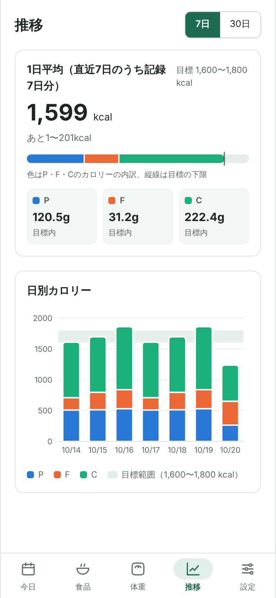
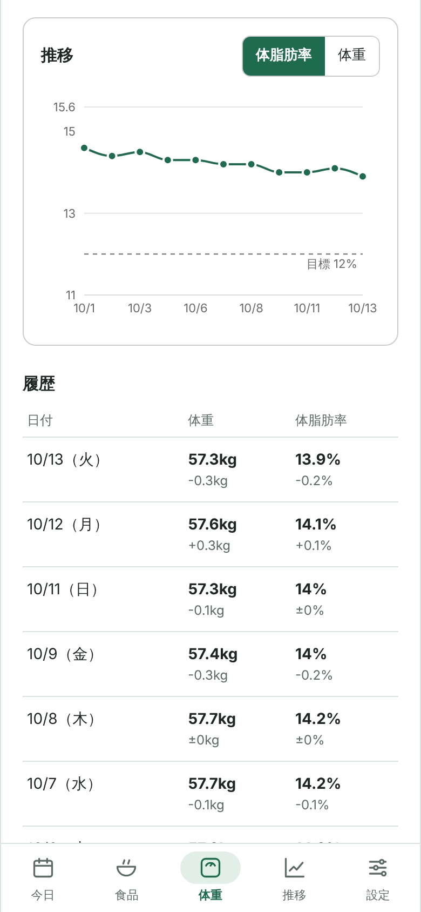
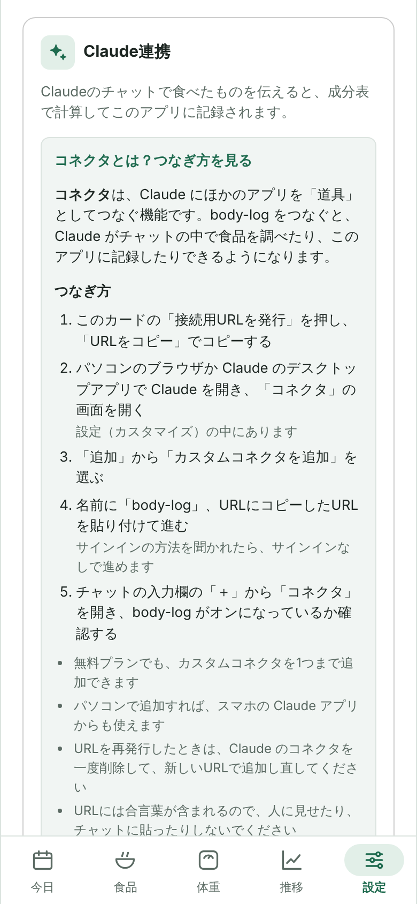
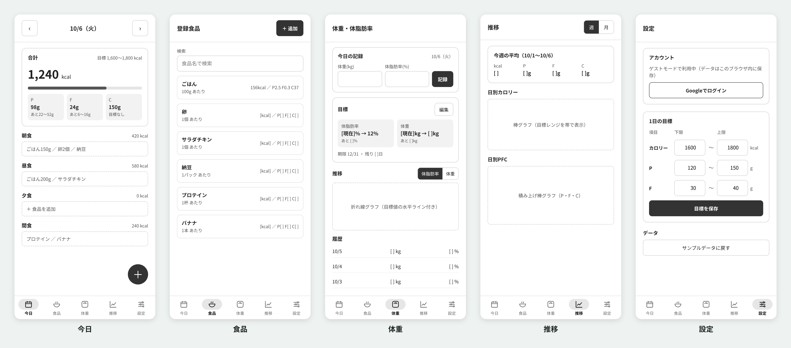

# body-log

[](https://github.com/yusuketoyoda0716-hash/body-log/actions/workflows/ci.yml)

食事のカロリー・PFCと、体重・体脂肪率を記録するWebアプリです。
減量・体づくりのために毎日続けていた食事記録を、自分で使うためにアプリにしました。

**公開URL：https://body-log-azure.vercel.app**

ログインなしの「ゲストモード」で、見本データ（直近2週間分の記録）が入った状態をそのまま試せます。初めて開くと、実際に操作しながら使い方を覚えられるチュートリアルが始まります。
Googleでログインすると、Claude のチャットで食べたものを伝えるだけで記録できる「Claude連携」も使えます。
スマホでは、公開URLを開いて「ホーム画面に追加」（Android の Chrome は「アプリをインストール」）を選ぶと、アプリとして使えます。

## スクリーンショット

| 今日の記録 | 食品の検索 | レシピ | チュートリアル |
| :---: | :---: | :---: | :---: |
|  |  |  |  |
| 推移 | 体重 | Claude連携 | |
|  |  |  | |

## 設計（ワイヤーフレーム）

実装の前に、画面構成と各画面に載せる項目をワイヤーフレームで決めてから作りました。
見た目の作り込みは後回しにして、「どの画面に何を表示するか」から必要なデータや処理を洗い出しています。



## 主な機能

- **食事の記録**：朝食・昼食・夕食・間食ごとに、登録した食品・レシピと量を記録。カロリーとPFCは自動で計算。間違えたときは消して記録し直せる
- **1日の合計と目標との差**：カロリーのバーをP・F・Cのカロリー内訳で色分けし、目標の下限・上限との位置関係を表示
- **食品の管理**：登録食品の検索・追加・編集・削除。食品の画面から「今日の食事に追加」で、そのまま今日の記録に入れられる
- **外食のメニュー**：よく行くお店のメニューを、店名ごとにまとめて登録できる「外食」タブ。店名・メニュー名で検索でき、公式の値がないメニューは「見積もり」の印付きで残せる
- **成分表から食品を登録**：日本食品標準成分表（約2,500食品）から検索して、100gあたりの値をそのまま登録。「鶏むね肉」「ごはん」のような普段の呼び方で探せる
- **よく食べるもの**：「ごはん」と検索すると「白米ごはん」「玄米ごはん」「麦ごはん（白米7：押麦3）」のように、よく食べる約400種類を分かりやすい名前で上に表示。成分表にない混ぜごはんは、成分表の値を割合で混ぜて計算
- **レシピ（作り置き・料理）**：材料と何食分かを入れると、1食あたりのカロリーとPFCを自動で計算。材料は登録食品・成分表・手入力（市販のルウなど）から選べ、作るたびに量が違っても編集して上書きできる。記録するときは「1食」「0.5食」で入れられる
- **Claude連携**：Claude のチャットで「夜 鶏むね200g ごはん150g」のように伝えると、成分表や登録食品から計算してアプリに記録し、その日の合計と目標との差を返す。料理やパッケージの写真、外食の店名とメニューからも記録できる
- **見積もりの表示**：外食で公式の値がないときや、写真から量を見積もったときは、記録に「見積もり」と表示し、1日の合計のうち見積もりがどれくらいかも出す
- **チュートリアル**：初回だけ自動で表示。実際の画面のボタンを光らせて、記録 → 確認 → 訂正 の流れを操作しながら覚えられる。設定の「使い方」から、最初からでも章ごとでも見直せる
- **推移**：直近7日／30日の1日平均と、日別カロリー（PFC積み上げ）のグラフ
- **体重・体脂肪率**：記録、前回との差、目標までの残りと期限までの日数、推移グラフ
- **目標の設定**：カロリー・P・F・Cそれぞれの下限と上限
- **スマホのホーム画面に追加（PWA）**：ホーム画面のアイコンから、アドレスバーのないアプリの画面で開ける。画面のファイルを端末に保存するので、2回目からすぐ開ける
- **2つの利用モード**
  - ゲスト：データはブラウザ内に保存（見本データ付き・いつでもリセット可能）
  - Googleログイン：Cloud Firestore に保存し、スマホとPCで同期

## 使用技術

| 分類 | 技術 |
| --- | --- |
| フロントエンド | React / TypeScript / Vite / React Router / CSS Modules |
| グラフ | Recharts |
| 認証・データベース | Firebase Authentication（Googleログイン）/ Cloud Firestore |
| サーバー（Claude連携） | Vercel Functions / MCP TypeScript SDK / Firebase Admin SDK / Zod |
| データ | 日本食品標準成分表（Excel から ExcelJS で JSON に変換） |
| PWA | vite-plugin-pwa（Web App Manifest・Service Worker） |
| ホスティング | Vercel |
| テスト・CI | Vitest / GitHub Actions |
| 開発ツール | ESLint / Git・GitHub |

## 設計で工夫したこと

### 1. 保存先を差し替えられる設計

データの保存・取得を `DataRepository` というインターフェースにまとめ、画面はインターフェースだけに依存する形にしました。

```
画面（React） → DataRepository（インターフェース）
                    ├─ LocalStorageRepository（ゲスト）
                    └─ FirestoreRepository（ログイン時）
```

- 最初から全メソッドを非同期（Promise）で統一していたため、Firestore 版を追加したときに**画面側のコードは変更せずに**保存先を切り替えられました
- ログイン状態に応じて使うリポジトリを React Context で切り替えています
- 「サンプルデータに戻す」はゲスト専用の機能なので、インターフェースのオプショナルメソッド（`reset?()`）にし、実装している保存先のときだけボタンを表示しています。本番データを一括削除できる経路を作らないためです

### 2. 記録時点の値を残す

食事記録には、食品IDだけでなく**記録した時点の食品名・単位・栄養素をコピーして保存**しています。登録食品の数値を後から直したり、食品を削除したりしても、過去の記録は変わりません。

### 3. 初回の読み込みを約半分に

ビルド時の「500kBを超えるファイルがある」という警告をきっかけに、バンドルの中身を確認しました。

- グラフ（Recharts）を使う「体重」「推移」画面を `React.lazy` で遅延読み込み
- Firestore はログインした人しか使わないため、リポジトリごと `import()` で遅延読み込み
- 成分表のデータ（約300kB）と、よく食べるものの一覧（約30kB）も、食品の検索画面を開いたときに初めて読み込む

その結果、最初に読み込むJavaScriptが **842kB → 436kB**（gzip後 258kB → 136kB）になり、ゲストで開いた人はグラフやデータベースのライブラリを読み込まずに使い始められます。レシピやチュートリアルなどの機能を足したあとにサイズを測り直し、検索画面でしか使わない「よく食べるもの」の一覧も、あとから読み込む形に変えました。

### 4. 日付と集計の扱い

- 日付は `YYYY-MM-DD` の文字列で扱い、`toISOString()`（UTC）を使わずローカルの日付から組み立てて、日本時間の早朝に前日扱いになるずれを防いでいます
- 表示中の日付はURL（`?date=`）に持たせ、再読み込みやブラウザの「戻る」でも同じ日を表示します
- 平均やグラフでは**記録がない日を0kcalとして数えない**ようにし、記録忘れで平均が下がらないようにしています
- 1日の区切りは**午前3時**にしています。夜中の0〜3時に食べた分は前の日の記録になります。アプリと Claude連携のサーバーで同じ区切りを使い、どちらから記録しても同じ日に入るようにしています

### 5. 成分表の検索

成分表の食品名は「にわとり ［若どり・主品目］ むね 皮なし 生」「こめ ［水稲めし］ 精白米 うるち米」のような書き方なので、そのままでは「鶏むね肉」「ごはん」で見つかりません。

- 「鶏 → にわとり」「ごはん → めし」のような**呼び方の置きかえ表**を用意
- キーワードを2文字ずつに区切って照合し、「とりむね」のように**言葉が離れていても**見つかるように
- カタカナ・ひらがな、全角・半角の違いをそろえてから比較
- 鶏皮などの［副品目］は下げ、白いごはん・若どりのような**定番の食品を上に**表示
- 検索の処理はほかのファイルに依存しない形にまとめ、**アプリの画面とサーバー（Claude連携）で同じコードを共有**しています

それでも「ごはん」で検索すると、陸稲（畑で作るお米）や精米の種類違いなど、ふだん食べないものも含めて16件並び、選びにくいままでした。そこで、よく食べるものの一覧（約400種類）を別に用意しています。

- 「白米ごはん」「豚ヒレ」「牛もも（国産）」のような**分かりやすい名前と、成分表の食品番号の対応表**を作り、検索結果のいちばん上に出す。もとにした成分表の食品名も小さく表示して、どの値か確かめられるようにしています
- 「すなぎも」「バゲット」「カルビ」のような別の呼び方や、「肉」「野菜」「和菓子」のようなまとめた言葉でも出るように、それぞれに検索語を持たせています
- 成分表にない「麦ごはん（白米7：押麦3）」は、白米ごはんと押麦ごはんの値を**重さの割合で混ぜて計算**し、計算のしかたを出典に残します
- 牛肉は同じ部位でも国産・輸入・和牛でカロリーが大きく違う（ヒレで123〜207kcal）ため、分けて用意しています
- 一覧への追加は1行で書けるようにして、食品を増やしやすくしています

### 6. レシピ（作り置き・料理）

カレーを4食分作るときのように、材料をまとめて調理して何回かに分けて食べるものは、食品1つでは表せません。

- 材料ごとに「基準量あたりの値」と「使った量」を持ち、**鍋全体の合計 ÷ 何食分**で1食あたりを計算します。計算はアプリと Claude連携のサーバーで同じ関数を使っています
- 作るたびに肉の量などが違うことが多いので、編集して上書きする形にしました。食事記録は記録した時点の値を持っているので、レシピを直しても**過去の記録は変わりません**
- 材料は登録食品・成分表・手入力（市販のルウなど成分表にないもの）から選べます。材料を選ぶ画面はダイアログを重ねず、同じダイアログの中で切り替えています

### 7. Claude との連携（MCPサーバー）

Claude が外部のツールを使うための仕組み MCP（Model Context Protocol）で、body-log 用のサーバーを Vercel Functions に置いています。

```
Claude（チャット）
   │ 「夜 鶏むね200g ごはん150g」
   ▼
/api/mcp（Vercel Functions）
   ├─ search_food          … レシピ・登録食品・成分表から探す
   ├─ add_meal_entries     … まとめて記録（量から計算／調べた値はそのまま）
   ├─ get_day_summary      … 1日の記録と合計、目標との差
   ├─ delete_meal_entries  … 記録を消す（訂正用）
   ├─ save_food            … 食品を登録・上書き
   ├─ save_recipe          … レシピを登録・上書き（1食あたりはサーバーで計算）
   └─ get_recipe           … レシピの材料を読み出す（量を変えて作り直すとき）
   │
   ▼
Cloud Firestore（その人のデータだけ）
```

- **AIの費用がかからない構成**：文章から食品と量を読み取る部分は、ユーザーが契約している Claude が担当します。アプリ側は Claude API を呼ばないので、従量課金が発生しません
- **接続用URLの合言葉はハッシュ値だけを保存**：設定画面で発行する接続用URLには、推測できないランダムな合言葉（256ビット）が入ります。Firestore には SHA-256 のハッシュ値だけを保存するので、データベースの中身を見られても接続用URLは作れません。URLは発行した直後にしか表示せず、再発行や解除もできます
- **サーバーは必ず uid で絞り込む**：サーバー用の鍵（Admin SDK）はセキュリティルールの外で動くため、合言葉から見つけた uid の `users/{uid}/` 以下だけを読み書きするようにしています
- **まとめて記録するときは全部成功か、全部失敗か**：存在しない食品が1件でもあれば何も保存せず、保存はバッチ書き込みで1回にまとめています
- **過去の記録も取り込める**：これまで別のチャットで計算していた記録は、値をそのまま記録する形式（`custom`）で取り込めます
- **入力のチェック**：Claude から受け取る値は Zod で形と範囲（量は0より大きい、日付は `YYYY-MM-DD` など）をチェックしています
- **ツールの使い方はサーバーが伝える**：探す順番、外食の扱い、訂正のしかたなどは MCP サーバーの説明（instructions）とツールの説明に書き、Claude に自動で伝わるようにしています。ユーザーにコピーしてもらうプロンプトには「すぐ記録する」「写真は確認してから記録する」のような方針だけを書き、機能を足してもプロンプトを書き直さなくて済むように役割を分けています
- **写真からの記録**：料理の写真は Claude が料理ごとに量を見積もり、一覧を見せて確認をとってから記録します。パッケージの栄養成分表示の写真は、書かれている値で食品を登録して記録します
- **外食はお店ごとに残す**：外食のメニューは店名とメニュー名を分けて保存し、アプリの「外食」タブに店ごとにまとめています。同じメニュー名でもお店が違えば別の食品として扱います。見積もりの値は基本的に残しませんが、定食・丼・ラーメンのように形が決まったメニューだけは、Claude が「外食に登録しておきますか？」と聞いて、「見積もり」の印付きで残します。食べ放題やお寿司のように中身がその日しだいのものは、その日の記録だけにしています
- **外食は値の確かさを区別する**：店名とメニューが送られたら「その店の公式の値 → 似たメニューのチェーン店の公式の値で代用 → 成分表のできあがりの料理や中身から見積もり」の順で値を決めます。どの方法の値かをツールの入力（`valueKind`）で受け取り、公式でない値は記録に「見積もり」の印を付け、登録食品には残しません。見積もりの数字が、次から「正しい値」として使われないようにするためです
- **コネクタの説明**：Claude の「コネクタ」を知らない人も多いため、設定画面につなぎ方の手順（URLのコピー → カスタムコネクタの追加 → チャットでオンにする）を載せています

### 8. スマホアプリとして使える（PWA）

アプリストアに出さずに、スマホのホーム画面から使えるようにしました。

- vite-plugin-pwa で Web App Manifest と Service Worker を生成し、ホーム画面のアイコン・アプリ名・テーマ色を設定
- Android で丸く切り抜かれても欠けないアイコン（maskable）と、iPhone 用のアイコンを用意
- 新しいバージョンを公開すると、次に開いたときに自動で入れ替わる
- 端末に保存した画面が Claude連携のサーバー（`/api/`）へのアクセスまで横取りしないように除外している

### 9. セキュリティ

- Firestore のセキュリティルールで、`users/{uid}/` 以下は**ログインしている本人だけ**が読み書きできるようにしています
- Claude連携の合言葉の表（`mcpTokens`）は、ブラウザからは「自分の uid のものを作る・消す」だけを許可し、読み取りはサーバーだけにしています
- Firebase の設定値やサーバー用の鍵は環境変数（`.env.local` / Vercel の Environment Variables）で管理し、リポジトリには含めていません。サーバー用の鍵は `VITE_` を付けない名前にして、ブラウザ側に渡らないようにしています

### 10. チュートリアル

ライブラリを使わず、実際の画面の上に案内を重ねる形で作りました。

- 説明したいボタンに `data-tour` という目印を付け、その位置に穴の空いた暗い影（スポットライト）と説明カードを重ねます。画面の読み込みを待つため、目印が見つかるまで少し探し続け、見つからなければ画面の真ん中に案内を出して先に進めるようにしています
- 「＋を押す」「食品を選んで追加する」「記録を消す」は**実際に操作すると次へ進む**ステップにしています。各画面から「追加した」「消した」のような合図を送り、チュートリアル側が待っている操作と合えば進めます。チュートリアルで追加した記録を、訂正のステップでそのまま消してもらうので、データは残りません
- 入力用のダイアログ（`<dialog>` の `showModal()`）は画面のいちばん上に重なり、外に出した案内は隠れてしまいます。そこで、ダイアログを開いている間は**案内をダイアログの中に表示**し、キャンセルで閉じたら1つ前のステップに戻るようにしています
- 見終わったことの保存先は、ゲストはブラウザ（「サンプルデータに戻す」で消えないよう別の場所）、ログインした人は Firestore にしました。ログインした人は、スマホとPCのどちらで開いても**初回の1回だけ**表示されます
- 設定の「使い方」から、最初からでも「記録を直す」「Claude連携」のような章ごとでも見直せます

### 11. 見やすさ・使いやすさ

- P・F・Cの3色は、色覚の違いがあっても隣り合って区別できるかを検証して選び、色だけに頼らず文字と数値も並べて表示しています
- アイコンだけのボタンには `aria-label`、表には `<table>` と `scope` を使うなど、読み上げにも配慮しています
- スマホでの片手操作を想定し、ボタンなどのタップ領域は44px以上にしています

### 12. 自動テストとCI

計算・日付・検索のような、間違っていても画面では気づきにくい中身の処理に、Vitest で単体テストを付けています（45件）。

- **栄養の計算**：量からの計算、合計、目標との差の文章、記録がない日を平均に含めないこと
- **レシピ**：鍋全体 ÷ 何食分、材料の量を変えて作り直したとき、何食分が0のとき
- **日付**：午前3時区切りの境目（2:59 と 3:00）、月末・年末の深夜、うるう年
- **検索**：「鶏むね肉」で若どり、「ごはん」で白いごはんが先頭に来ること。よく食べるものがすべて成分表とつながっていること、麦ごはんの混ぜた値が合っていること
- **外食のメニュー**：「店名 メニュー名」の表示、同じメニュー名でもお店が違えば別の食品として扱うこと、店名ごとのまとめ方

テストを書いたことで、**小数の誤差で四捨五入がずれる問題**が見つかりました。鶏むね肉（脂質1.9g/100g）を150g食べると脂質は2.85gですが、計算機の中では 2.8499999… になり、四捨五入すると 2.8g になっていました。10倍した値の小数の誤差を消してから四捨五入する形に直し、アプリとサーバーで同じ関数を使うようにまとめています。

GitHub Actions で、プッシュのたびに lint・テスト・型チェック・ビルドを自動で実行しています。

## データ構成（Firestore）

```
users/{uid}/
  ├─ foods/{foodId}          … 登録食品（出典つき。外食のメニューは店名と、見積もりかどうかも持つ）
  ├─ recipes/{recipeId}      … レシピ（材料・何食分・1食あたりの値）
  ├─ entries/{entryId}       … 食事記録（記録した時点の値。見積もりなら estimated: true）
  ├─ bodyRecords/{date}      … 体重・体脂肪率（日付をIDにして1日1件）
  └─ settings/
       ├─ goals              … 1日の目標（kcal・P・F・C）
       ├─ bodyGoal           … 体組成の目標
       ├─ tutorial           … チュートリアルを見終わった日時
       └─ mcp                … Claude連携の状態（合言葉のハッシュ値・発行日時）

mcpTokens/{ハッシュ値}         … 合言葉から uid を探すための表（サーバーだけが読む）
```

## ローカルでの起動

```bash
git clone https://github.com/yusuketoyoda0716-hash/body-log.git
cd body-log
npm install
```

`.env.example` をコピーして `.env.local` を作り、Firebase の設定値を入れます。

```bash
cp .env.example .env.local
npm run dev
```

ゲストモードだけなら、Firebase の設定がなくても画面の確認はできます。

```bash
npm test        # 単体テストを1回実行
npm run lint    # コードのチェック
```

- Claude連携のサーバー（`api/mcp.ts`）は Vercel Functions として動くため、`npm run dev` では動きません。Vercel にデプロイし、環境変数 `FIREBASE_SERVICE_ACCOUNT` に Firebase のサービスアカウントの鍵（JSON）を設定して使います
- 成分表の JSON は `src/data/mextFoods.json` に含めています。作り直すときは、文部科学省のサイトから「日本食品標準成分表（八訂）増補2023年」の第2章（本表）の Excel をダウンロードして `scripts/mext/seibunhyo.xlsx` に置き、`npm run convert:mext` を実行します

## 今後の予定

- **アプリ内のまとめて入力**：「鶏むね 200g」のように1行1品で書いて、まとめて記録できるようにする（AIを使わず、成分表とよく食べるものの検索の仕組みを使う）
- **市販品のバーコード読み取り**：無料の商品データベース（Open Food Facts）を使って、パッケージの栄養成分を取り込めるか試す

## 出典

食品の栄養成分は、文部科学省「日本食品標準成分表（八訂）増補2023年」をもとにしています。
